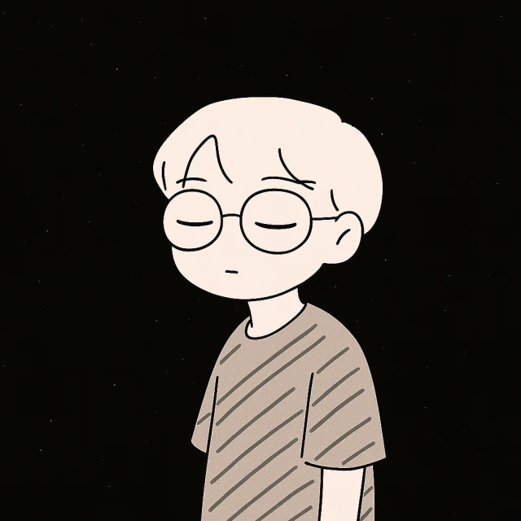

## Cree

**크리** · 이종민 (Jongmin Lee)

추천시스템과 신경망 구조에 관심이 있습니다.  
직접 모델을 학습시키고, 로컬에서 쓸 수 있는 검색·학습 도구를 만듭니다.

  <a href="https://cree1116.github.io/"><b>포트폴리오</b></a> &nbsp;·&nbsp;
  <a href="https://huggingface.co/lCREEl"><b>Hugging Face</b></a>

 

**관심 분야** &nbsp; 추천시스템 / 신경망 아키텍처 / 정보 검색  
**주로 쓰는 도구** &nbsp; <kbd>Python</kbd> <kbd>Rust</kbd> <kbd>C++</kbd> <kbd>TypeScript</kbd> <kbd>PyTorch</kbd>

<b>학회 발표</b>

- **KrAIS 2026 Summer Workshop**  
  *On the Necessity and Fundamental Limits of Exposure Bias Correction in Linear Autoencoder-based Recommenders*  
  Jongmin Lee, Iljoo Kim. [공식 프로그램 8쪽](https://drive.google.com/file/d/1YYMeWxe7VBaqp64eN5QJrHtBg6G59GYv/view)

- **KDBC 2025**  
  CSAR: 공동 지지 어텐션을 이용한 다중관심사 추천 모델  
  Jongmin Lee, Iljoo Kim. [공식 프로그램](https://www.dbsociety.kr/kdbc/kdbc2025/program.html)

